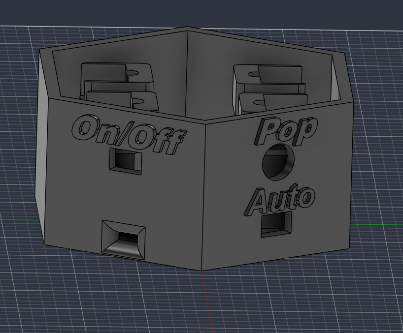
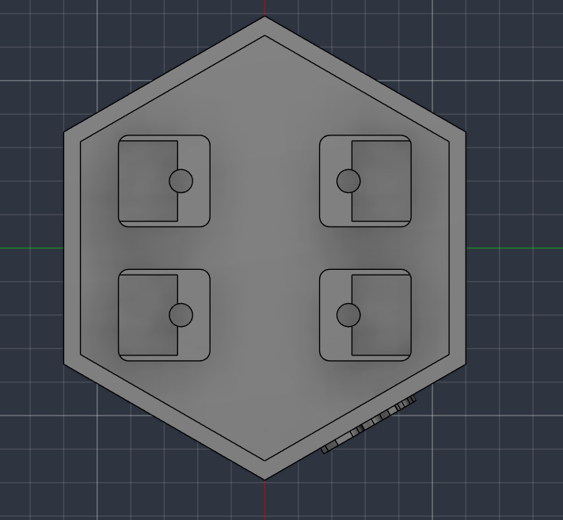
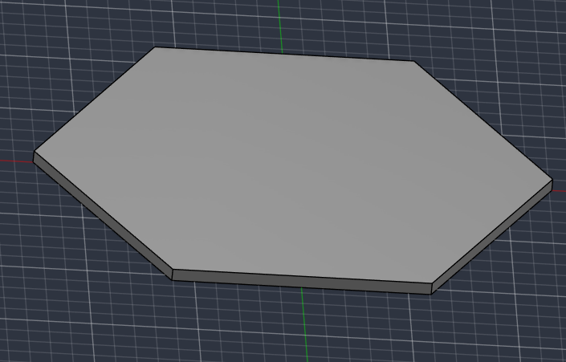

The # DicePopper is going to be a box with an opening, that rolls your dice for you!

Why?
- I spend a lot of time playing D&D, table top games, and board games, and when my luck just gets too good... people get suspicious. With this, I will be able to roll more systematically.
- I play a home rule variant of Catan where there are no turns, and the dice roll at select intervals. Currently, this doesn't work very well because people still have to roll. With this, I will have a switch that will make it automatically roll every 30 seconds.

Main functions:
- When you click the push-button on the outer case, it will move the plate up and down for a few seconds.l
- When you flick the switch below the push-button, it will roll the dice every 30 seconds.

I wrote the firmware using Arduino IDE and C++. The code firstly includes the servo library and then defines the 4 servo motors. In the setup, it defines some pins, creates servo bodies, and writes all servos to their home position. In the loop there are two if statements: The first one is for the pushbutton and when it is clicked, it will shake the plate a bit before returning to its home position. The second if statement is for the switch, and when it is flicked, the servos will do the same thing as before every 30 seconds.
I have included the .ino file for the code in the firmware folder. [Here](Firmware/Dicepopper.ino)

This is the design I made for the box in Fusion360. You can find my source files and exported .stl files in the CAD folder [Here](CAD/).
The design features 3 parts:
- There is the bottom part, that houses the electronics, including the servo mounts, buttons/inputs, the power system, and the arduino. There is also text on top of the switches and button so that users will understand what they do.

The servo mounts are pillars with cuts for the servos, and pipes for the wires to reach the bottom.

- There is the popper plate, which will carry the dice and get popped around by the servos.

- There is the top case, which keeps the dice and popper plate from flying out of the box.

My BOM.csv file is in the same place as this in the REPO, in the root under main. Otherwise click [this](BOM.csv).
And as always, thanks for reading.
